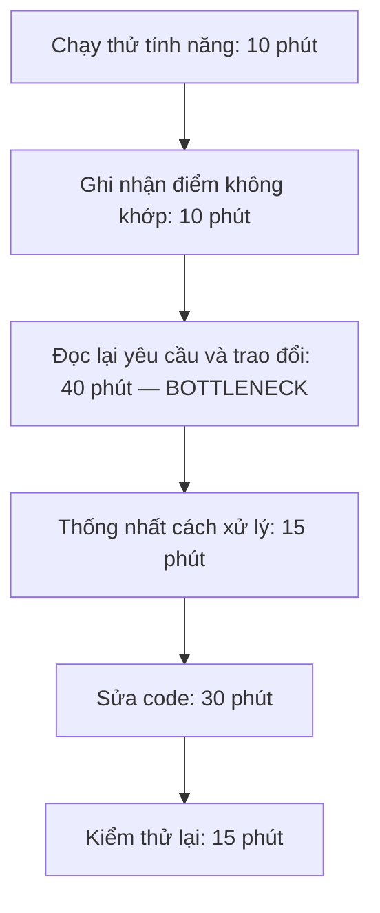
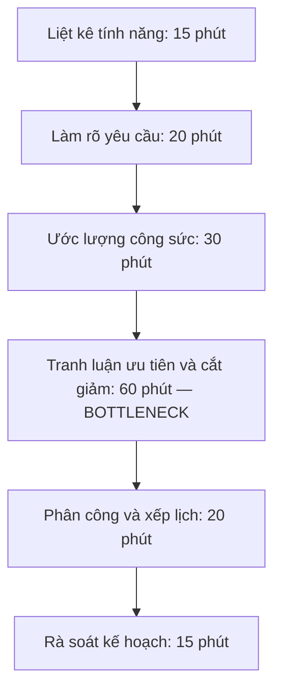
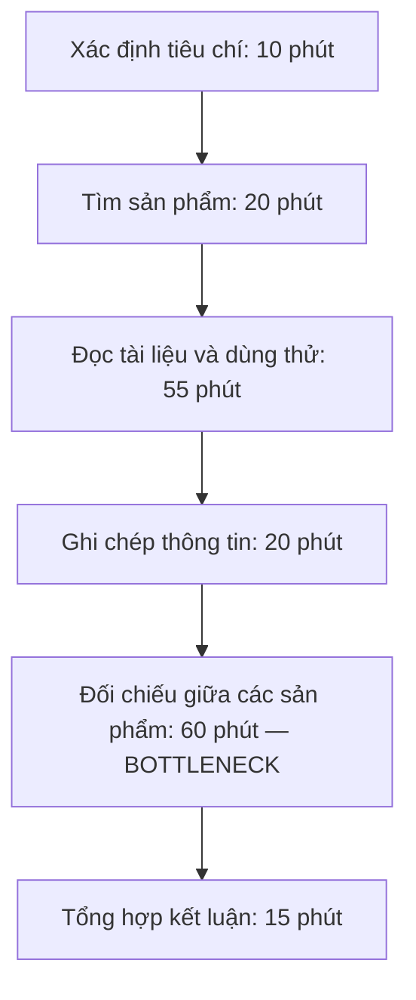

# Báo cáo cá nhân — 2A202603986_LeHaiAnh

## 1. Thông tin học viên

- Họ tên: Lê Hải Anh    
- MSSV: 2A202603986
- Email trường (không bắt buộc, repo có thể để public):
- Tên nhóm: FreeFire
- Link repo nhóm:https://github.com/nhan54v-boop/K5-L3B-Day02-FreeFire-DiscoveryProblemFraming.git

---

## 2. Scan problem (CP1)

Lăng kính: **Lặp lại** · **Tốn thời gian** · **Cần đọc, tổng hợp nhiều thông tin** · **Pain từ người khác**.

| # | Lăng kính | Job Story: Khi… tôi muốn… để… | Ai chịu ảnh hưởng? | Dấu hiệu (số liệu minh họa, chưa xác nhận) |
|---:|---|---|---|---|
| 1 | Tốn thời gian | Khi nhóm có nhiều ý tưởng đề tài, tôi muốn so sánh chúng theo những tiêu chí thống nhất, để chốt được hướng làm mà các thành viên đều hiểu lý do lựa chọn. | Nhóm sinh viên làm đồ án | Nhóm cân nhắc 4 ý tưởng, họp 2 buổi với tổng thời gian khoảng 3 giờ mới chốt đề tài. |
| 2 | Pain từ người khác | Khi cân nhắc một đề tài ngoài trải nghiệm của nhóm, tôi muốn tiếp cận người thực sự gặp vấn đề và hiểu cách họ đang xử lý, để biết đề tài có đáng theo đuổi trước khi bắt đầu xây. | Thành viên phụ trách tìm hiểu người dùng | Nhóm liên hệ 5 người nhưng chỉ 2 người phản hồi sau 3 ngày; lúc đó nhóm đã bắt đầu thiết kế giao diện. |
| 3 | Đọc, tổng hợp nhiều thông tin | Khi tìm hiểu các sản phẩm đã giải quyết vấn đề tương tự, tôi muốn xác định họ đã làm tốt phần nào và người dùng còn vướng ở đâu, để quyết định phần đóng góp cụ thể của đề tài. | Người nghiên cứu đề tài | Mất khoảng 3 giờ tìm hiểu 5 sản phẩm, sau đó phải mở lại các nguồn để đối chiếu tính năng và giới hạn. |
| 4 | Tốn thời gian | Khi danh sách tính năng vượt quá thời gian và nhân lực hiện có, tôi muốn xác định phần tối thiểu cần hoàn thành để kiểm chứng giá trị chính, để nhóm có một sản phẩm dùng thử được trước hạn. | Nhóm trưởng và thành viên phát triển | Nhóm dự kiến 10 tính năng trong 4 tuần nhưng phải hoãn 3 tính năng; chỉ còn 2 ngày kiểm thử trước khi nộp. |
| 5 | Lặp lại | Khi các thành viên hiểu khác nhau về cùng một tính năng, tôi muốn thống nhất hành vi mong đợi và điều kiện được xem là hoàn thành, để các phần ghép lại hoạt động đúng và giảm việc sửa lại. | Người làm giao diện, backend và kiểm thử | Trong một lần tích hợp, frontend và backend không thống nhất dữ liệu trả về; phải trao đổi 3 lượt và sửa khoảng 2 giờ. |

**Nếu có dùng AI để gợi ý thêm:**

- **Công cụ:** ChatGPT.
- **Ý giữ lại:** Gợi ý về so sánh đề tài, tiếp cận người dùng, tổng hợp sản phẩm tương tự, giới hạn phạm vi tính năng và thống nhất yêu cầu trong nhóm.
- **Ý loại bỏ:** Khôi phục bối cảnh khi quay lại code, lỗi chỉ xuất hiện trên máy thành viên khác và báo lỗi thiếu bước tái hiện.
- **Lý do loại bỏ:** Muốn tập trung vào khó khăn khi xác định hướng đi, phạm vi và yêu cầu sản phẩm.

---

## 3. Top 3 Problem Cards + quy trình nháp (CP2)

### Bảng chọn top 3

| Rank | Problem | Vì sao chọn | Điều còn chưa chắc |
|---:|---|---|---|
| 1 | Thành viên hiểu khác nhau về yêu cầu tính năng | Actor rõ, quy trình cụ thể; đo được thời gian làm rõ, sửa lại và số lượt trao đổi. | Nguyên nhân chính là yêu cầu thiếu rõ ràng hay thành viên không đọc kỹ? |
| 2 | Danh sách tính năng vượt quá thời gian và nhân lực | Ảnh hưởng trực tiếp đến tiến độ và thời gian kiểm thử; gần trải nghiệm làm đồ án nhóm. | Nhóm chọn quá nhiều tính năng hay ước lượng công sức chưa đúng? |
| 3 | Khó tổng hợp, so sánh các sản phẩm tương tự | Phải đọc nhiều nguồn, có thể đo thời gian tổng hợp và chất lượng bảng so sánh. | Thời gian chủ yếu mất ở tìm nguồn hay đối chiếu thông tin? |

### Problem Card #1

| Trường | Nội dung |
|---|---|
| Job Story | Khi các thành viên hiểu khác nhau về cùng một tính năng, tôi muốn thống nhất hành vi mong đợi và điều kiện được xem là hoàn thành, để các phần ghép lại hoạt động đúng và giảm việc sửa lại. |
| Actor | Thành viên frontend, backend và người phụ trách kiểm thử trong nhóm sinh viên làm sản phẩm. |
| Thời điểm / bối cảnh | Khi tích hợp một tính năng do nhiều thành viên cùng phát triển, chẳng hạn cập nhật thông tin tài khoản. |
| Quy trình hiện tại (3–7 bước) | Chạy thử tính năng → ghi nhận điểm không khớp → đọc lại yêu cầu và trao đổi → thống nhất cách xử lý → sửa code → kiểm thử lại. |
| Bottleneck (bước nào, mất bao nhiêu phút) | Đọc lại yêu cầu và trao đổi để xác định hành vi đúng, khoảng 40 phút/lần do thông tin nằm rải rác và thiếu ví dụ cụ thể. |
| Impact (nếu không giải thì sao) | Phải sửa phần đã làm, chậm tích hợp và giảm thời gian kiểm thử các chức năng khác. |
| Success metric (baseline → target) | Thời gian làm rõ một bất đồng yêu cầu: khoảng 40 → không quá 20 phút. Ghi thời gian trên 3 trường hợp tiếp theo, đồng thời theo dõi số lần phải mở lại cùng bất đồng. |
| Phương án không dùng AI | Dùng một tài liệu yêu cầu chung; bổ sung ví dụ đầu vào/đầu ra, điều kiện hoàn thành và người chốt yêu cầu trước khi chia việc. |
| Giả thuyết về AI (nếu có) | AI có thể đối chiếu tài liệu với trao đổi để chỉ ra chỗ thiếu hoặc mâu thuẫn. Con người xác nhận yêu cầu cuối cùng; cần kiểm tra xem checklist có đủ giải quyết vấn đề không. |
| Cảm nhận nhanh | Chưa biết — ưu tiên thử No AI trước. |

Quy trình nháp hiện tại:

Tổng thời gian minh họa: 120 phút cho một lần xử lý bất đồng khi tích hợp.

### Problem Card #2

| Trường | Nội dung |
|---|---|
| Job Story | Khi danh sách tính năng vượt quá thời gian và nhân lực hiện có, tôi muốn xác định phần tối thiểu cần hoàn thành để kiểm chứng giá trị chính, để nhóm có một sản phẩm dùng thử được trước hạn. |
| Actor | Nhóm trưởng và thành viên phát triển trong nhóm sinh viên làm đồ án. |
| Thời điểm / bối cảnh | Khi lập hoặc điều chỉnh kế hoạch cho dự án có deadline cố định và các thành viên còn phải học những môn khác. |
| Quy trình hiện tại (3–7 bước) | Liệt kê tính năng → làm rõ yêu cầu → ước lượng công sức → tranh luận ưu tiên và cắt giảm → phân công, xếp lịch → rà soát kế hoạch. |
| Bottleneck (bước nào, mất bao nhiêu phút) | Tranh luận ưu tiên và cắt giảm tính năng, khoảng 60 phút/buổi vì chưa thống nhất tiêu chí và phụ thuộc giữa các tính năng. |
| Impact (nếu không giải thì sao) | Nhóm làm dàn trải, hoàn thành muộn luồng chính và thiếu thời gian kiểm thử trước khi nộp. |
| Success metric (baseline → target) | Thời gian chốt phạm vi trong một buổi lập kế hoạch: khoảng 60 → không quá 30 phút cho bước ưu tiên. Theo dõi thêm việc hoàn thành luồng chính trước deadline ít nhất 5 ngày trong dự án thử nghiệm. |
| Phương án không dùng AI | Xác định một luồng người dùng cốt lõi; chấm mức cần thiết, công sức và phụ thuộc của từng tính năng; giới hạn công việc theo thời gian thực có. |
| Giả thuyết về AI (nếu có) | AI có thể chỉ ra phụ thuộc hoặc yêu cầu chưa rõ trong danh sách tính năng. Ước lượng công sức và quyết định cắt giảm vẫn do nhóm thực hiện. |
| Cảm nhận nhanh | No AI — cần kiểm chứng hiệu quả của tiêu chí ưu tiên và cách lập kế hoạch trước. |

Quy trình nháp hiện tại:

Tổng thời gian minh họa: 160 phút cho một buổi lập kế hoạch phạm vi.

### Problem Card #3

| Trường | Nội dung |
|---|---|
| Job Story | Khi tìm hiểu các sản phẩm đã giải quyết vấn đề tương tự, tôi muốn xác định họ đã làm tốt phần nào và người dùng còn vướng ở đâu, để quyết định phần đóng góp cụ thể của đề tài. |
| Actor | Thành viên phụ trách nghiên cứu sản phẩm tương tự trong nhóm đồ án. |
| Thời điểm / bối cảnh | Khi cần so sánh các sản phẩm trước khi đề xuất hoặc điều chỉnh hướng phát triển. |
| Quy trình hiện tại (3–7 bước) | Xác định tiêu chí → tìm sản phẩm → đọc tài liệu và dùng thử → ghi chép → đối chiếu giữa các sản phẩm → tổng hợp kết luận. |
| Bottleneck (bước nào, mất bao nhiêu phút) | Đối chiếu thông tin giữa các sản phẩm, khoảng 60 phút vì ghi chép chưa theo cùng cấu trúc và phải mở lại nguồn. |
| Impact (nếu không giải thì sao) | Mất thời gian tra cứu lại, dễ so sánh thiếu công bằng hoặc kết luận sai rằng sản phẩm khác chưa có một tính năng. |
| Success metric (baseline → target) | Thời gian đối chiếu 5 sản phẩm: khoảng 60 → không quá 30 phút, với cùng bộ tiêu chí. Mọi nhận định trong bảng phải có nguồn hoặc ghi rõ “chưa xác minh”. |
| Phương án không dùng AI | Thống nhất tiêu chí trước khi tìm hiểu; dùng bảng ghi chép chung có link nguồn, ngày kiểm tra và trạng thái xác minh. |
| Giả thuyết về AI (nếu có) | AI có thể trích thông tin từ các tài liệu đã cung cấp vào bảng so sánh. Người nghiên cứu phải mở nguồn kiểm tra; AI không được suy ra “không có tính năng” chỉ vì tài liệu không đề cập. |
| Cảm nhận nhanh | Chưa biết — thử bảng chuẩn trước, cân nhắc Workflow nếu bước đọc và trích thông tin vẫn tốn nhiều thời gian. |

Quy trình nháp hiện tại:

Tổng thời gian minh họa: 180 phút để nghiên cứu và so sánh 5 sản phẩm.

### Card muốn pitch nhất

- **Card số:** 1.
- **Vì sao:** Vấn đề có actor và quy trình rõ, có thể kiểm chứng bằng một lần tích hợp cụ thể và lịch sử trao đổi. Có thể thử cải thiện bằng tài liệu, checklist trước khi cân nhắc AI.
- **Câu hỏi muốn nhóm phản biện:** Nếu đã có tài liệu yêu cầu chung và điều kiện hoàn thành rõ ràng, vấn đề hiểu sai còn xảy ra không? Bước nghẽn nằm ở tài liệu hay cách phối hợp?

### AI đã phản biện card thế nào

| Điểm yếu AI chỉ ra | Đồng ý? | Đã sửa gì |
|---|---|---|
| Card #1 có thể giải quyết bằng tài liệu và checklist, chưa có cơ sở chọn AI. | Đồng ý | Giữ mức chọn là “Chưa biết”, ưu tiên thử tài liệu yêu cầu chung và checklist trước. |
| Card #2 có thể chậm vì ước lượng sai, không chỉ vì khó ưu tiên. | Đồng ý | Bổ sung việc ước lượng công sức vào quy trình và ghi rõ cần phân biệt hai nguyên nhân này khi kiểm chứng. |
| Card #3 dễ nhầm “không tìm thấy thông tin” với “sản phẩm không có tính năng”. | Đồng ý | Bổ sung yêu cầu ghi “chưa xác minh” khi thiếu thông tin và kiểm tra nguồn trước khi kết luận. |
---

## 4. Tôi đã tham gia phần nào (CP3 → CP7)

| **Hoạt động** | **Tôi đã làm gì?** | **Kết quả / ảnh hưởng tới bài nhóm** |
|---|---|---|
| Pitch Problem Card | Tôi đưa ra ba card về hiểu sai yêu cầu tính năng (#4), chọn phạm vi đồ án (#5) và so sánh sản phẩm tương tự (#6). Tôi chọn #4 để pitch. | Card #4 vào danh sách rút gọn, đạt 25/35 điểm. |
| Phản biện bài của bạn khác | **Câu hỏi tôi đã đặt:** tôi hỏi Hiệu về card #7 là *“Trong 5 lần bạn bấm giờ, dòng mô tả đồ án nào dùng lại được, dòng nào phải viết lại theo JD?”* | Câu này giúp kiểm tra khi nào một bộ câu mô tả có sẵn là đủ. Nhóm giữ CV cố định và bộ câu mô tả làm phương án đối chứng. |
| Nhận phản biện | **Câu hỏi tôi nhận được:** Hiệu hỏi tôi về card #4 là *“Nếu đã có tài liệu yêu cầu chung và điều kiện hoàn thành rõ, hiểu sai còn xảy ra không?”* | **Tôi đã sửa gì:** Sau phản biện ở CP2, tôi bổ sung ví dụ đầu vào, đầu ra và người chốt yêu cầu. Tôi chọn thử checklist trước. |
| Gom cluster / cây OST | Ba card của tôi được đưa vào phần gom nhóm do Nhân phụ trách. | Nhân xếp #4 và #5 vào nhóm C (thống nhất yêu cầu và phạm vi), còn #6 vào nhóm A (đọc và đối chiếu nhiều nguồn). |
| Chọn candidate problem | Tôi đưa card #4 vào so sánh. Hạn chế của card là thời gian làm rõ yêu cầu mới chỉ là số minh họa. | Nhóm chọn card #7 của Hiệu (33/35). Hiệu có số bấm giờ từ 5 lần sửa CV và xác định được bước viết lại mô tả đồ án. |
| Kiểm chứng / research | Tôi phụ trách CP4, có Nhân hỗ trợ. Phần này tổng hợp số bấm giờ của Hiệu, ghi chép nội bộ và bảng so sánh Teal, Jobscan, Kickresume, TopCV. | Hiệu mất trung bình 45 phút/CV, trong đó khoảng 20 phút để viết lại mô tả đồ án. Nhóm thu hẹp đối tượng xuống sinh viên thường sửa CV theo từng JD. Phỏng vấn ngoài nhóm vẫn cần bổ sung. |
| Quy trình nhóm | Phần CP4 của tôi cung cấp thông tin cho Hiệu vẽ quy trình trước và sau khi dùng công cụ. | Quy trình đề xuất có bước lọc JD, nháp câu từ đồ án thật và sinh viên duyệt từng dòng. Thời gian 14 phút/CV là dự kiến. |
| Problem Statement | Phần kiểm chứng tôi phụ trách là căn cứ để Hiệu viết v0 và Dũng hoàn thiện v1. | Bản v1 ghi cả tốc độ và chất lượng: dưới 15 phút/CV, viết lại dưới 50% bản nháp và mỗi dòng đều truy được về đồ án thật. |
| Mức can thiệp AI | Phần khảo sát CP4 cung cấp cho Dũng hai cách để so sánh: dùng CV cố định hoặc dùng công cụ hỗ trợ viết nháp. | Nhóm chọn thử Workflow. AI lọc JD và nháp các dòng mô tả, còn sinh viên chọn đồ án, kiểm tra nội dung và tự nộp. |
| Quyết định | Giới hạn của phần tôi phụ trách là số bấm giờ mới đến từ một người. Nhóm còn cần kiểm tra liệu cách dùng CV cố định đã đủ nhanh chưa. | Nhóm chốt **Go, phạm vi nhỏ**: thử 2 tuần, ít nhất 5 CV/người. Nếu cách dùng CV cố định đạt dưới 15 phút/CV thì quay về cách đó. |

---

## 5. Dùng AI

| Checkpoint | Tôi dùng AI để làm gì? | AI hữu ích ở đâu? | AI sai hoặc hời hợt ở đâu? | Tôi sửa gì bằng nhận định của mình? |
|---|---|---|---|---|
| CP4 | Khi viết báo cáo, đối chiếu ghi chép kiểm chứng với dữ liệu của nhóm. | Giúp tôi phân biệt 5 lần Hiệu tự bấm giờ với con số 35–40 phút/CV tôi ước lượng theo trí nhớ. | Bảng tóm tắt nêu 45 phút/CV nhưng chưa làm rõ cả 5 lần đo đều của Hiệu. | Tôi ghi rõ nguồn của từng số. Nhóm vẫn cần hỏi sinh viên ngoài nhóm để biết họ mất thời gian ở bước nào. |
| CP5–CP6 | Rà lại quy trình, mục tiêu và quyết định thử Workflow. | Giúp tôi phân biệt thời gian dự kiến 14 phút/CV với mục tiêu dưới 15 phút/CV. | Khi rút gọn, AI chỉ nhắc thời gian và bỏ sót tiêu chí chất lượng của bản nháp CV. | Tôi ghi cả hai điều kiện: sửa lại dưới 50% bản nháp và 100% dòng mô tả phải truy được về đồ án thật. Hiệu quả sẽ được đo trong đợt thử 2 tuần. |
---

## 6. Reflection (CP7)

Trả lời bằng trải nghiệm thật của bạn, tối thiểu 200 từ cho các câu 6.1–6.6 (không tính 6.7, câu này được chấm riêng ở tiêu chí C5). **Không dùng AI để viết thay.**

**6.1. Tôi học được gì từ các card khác?** Hiệu bấm giờ cả lúc sửa CV nên chỉ được bước nào mất lâu nhất. Với card của tôi, 40 phút đọc lại yêu cầu vẫn là con số minh họa. Nếu mang card đi pitch lần nữa, tôi sẽ chọn một lỗi tích hợp cụ thể và xem lại tin nhắn từ lúc phát hiện đến lúc thống nhất cách sửa.

**6.2. Nhóm từng nghĩ đến giải pháp quá sớm ở đâu?** Khi vẽ cây cơ hội, nhóm gạch hai ý “AI tự viết CV” và “Agent tự nộp đơn”. Câu hỏi còn lại dễ kiểm tra hơn nhiều. Khi gặp một JD mới, sinh viên mất bao lâu để viết lại vài dòng về đồ án của mình?

**6.3. Tôi sửa gì sau phản biện?** Với card 1, tôi đồng ý thử ghi một ví dụ đầu vào và đầu ra ngay trong yêu cầu tính năng. Nếu hai bên thống nhất được bằng ví dụ đó, nhóm đã có cách xử lý ngay ở lúc giao việc.

**6.4. Chi tiết nào đáng chú ý khi kiểm chứng?** Trong ghi chép nội bộ, Nhân mất khoảng 10–15 phút để sửa phần giới thiệu trên CV chung. Dũng dùng 2 bản CV cố định, thường mất 10–15 phút nhưng có thể mất khoảng 30 phút khi JD khác nhiều. Hai trường hợp này khiến việc đo thời gian của cách sửa tay đáng làm trước khi thử Workflow.

**6.5. Điều gì khó khi viết Problem Statement?** Viết “giảm thời gian sửa CV” thì dễ, nhưng bản nháp có thể nhanh mà lại thêm một kỹ năng ứng viên chưa từng dùng. Vì vậy nhóm còn kiểm xem từng dòng có truy được về đồ án thật hay không.

**6.6. Nếu làm lại, tôi sẽ đổi gì?** Tôi sẽ tìm một bạn ngoài nhóm vừa nộp hồ sơ, xin họ kể lại lần sửa CV gần nhất và chỉ ra dòng phải viết lại lâu nhất. Như vậy tôi có thể kiểm tra giả định của nhóm ngay ở CP4.

**6.7. Tôi hiểu bài toán của nhóm thế nào?** Nhóm chọn sinh viên CNTT năm cuối phải chỉnh CV theo từng mô tả công việc (JD). Trong 5 lần Hiệu bấm giờ, trung bình mỗi CV mất 45 phút, riêng phần viết lại mô tả đồ án mất khoảng 20 phút. Mục tiêu là dưới 15 phút/CV, sửa lại dưới 50% bản nháp và kiểm được nguồn của từng dòng. Trong Workflow đề xuất, AI lọc JD và nháp câu chữ từ dữ liệu thật, còn sinh viên chọn đồ án, duyệt từng dòng và tự nộp. Nhóm chọn **Go ở phạm vi nhỏ**, thử trong 2 tuần với ít nhất 5 CV/người để so sánh Workflow với cách dùng CV cố định. Nếu cách dùng CV cố định đã đạt dưới 15 phút/CV, nhóm quay về cách đó. Nếu hai CV liên tiếp phải viết lại quá nửa bản nháp hoặc có thông tin sai lọt qua tới lúc nộp, nhóm dừng thử.

---

## 7. Tài liệu tham khảo
- Teal AI Resume Builder: https://www.tealhq.com/free và https://tealhq.com/resume-builder
- Jobscan Match Report: https://jobscan.co/resume-matcher và https://www.jobscan.co/resume-checker
- Kickresume (AI Writer, giá): https://www.kickresume.com/pricing
- TopCV, tạo CV online theo mẫu: https://www.topcv.vn/cach-tao-cv-online-tren-topcv
- Hướng dẫn dùng AI viết CV (tiếng Việt, blog): https://findskill.ai/vi/blog/ai-viet-cv-xin-viec-2026-huong-dan-tieng-viet/
- Rezi, bài tổng hợp công cụ viết CV (blog của nhà bán công cụ): https://www.rezi.ai/posts/rezi-alternatives
- Rob Fitzpatrick, *The Mom Test* (3 luật phỏng vấn dùng ở mục 3.2)
- Google PAIR, *People + AI Guidebook* (hai câu hỏi augment/automate và báo nhầm/bỏ sót ở mục 6.4)
